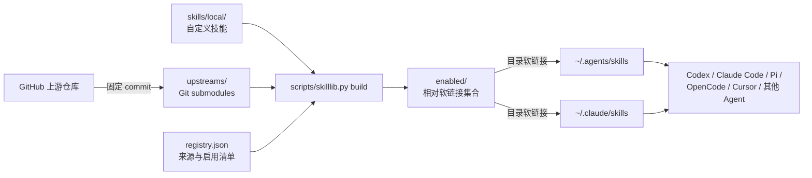

# Skill Library

个人 AI Code Agent 技能聚合仓库。它把自己维护的技能与单独保留的 Lark/Feishu 第三方技能统一收纳、固定版本、按清单启用，再通过软链接提供给 Claude Code、Codex、OpenCode、Pi、Cursor 等支持 Agent Skills 目录的工具。

这个仓库主要解决以下问题：

- 不再为每个 Code Agent 分别复制、安装和更新同一批技能。
- 第三方技能保留原始 Git 仓库，后续可以查看差异并持续更新。
- 自定义技能和第三方技能分开管理，避免来源混乱。
- 明确选择真正启用的第三方技能，上游新增内容不会未经确认自动进入全局环境。
- 所有全局入口最终指向同一份 `enabled/`，修改一次即可供多个 Agent 使用。
- 上游更新由 GitHub Actions 定期检查并提交 Pull Request，不直接改写 `main`。

> `enabled/` 是生成结果，不是技能源文件。自定义技能应修改 `skills/local/`，第三方技能应通过 submodule 更新，不要直接编辑 `enabled/` 中的内容。

## 当前内容

仓库目前聚合：

- 17 个自定义技能，位于 `skills/local/`。
- 27 个 Lark/Feishu 第三方技能，来自 1 个 GitHub 仓库。
- 共 44 个统一技能入口，位于 `enabled/`。

第三方来源、对应仓库和官方安装命令见 [SOURCES.md](SOURCES.md)。该文件由脚本根据 `registry.json` 自动生成。

## 当前维护策略

本仓库把第三方领域能力和个人开发工作流明确分开：

- Lark/Feishu 技能依赖官方 CLI、API 和持续更新的产品能力，因此保留 `larksuite/cli` 作为唯一第三方 submodule。
- 通用开发流程不再聚合多个第三方技能套件，避免需求访谈、规划、实现、测试和评审规则重复触发。
- 开发工作流由本仓库中的 `development-workflow` 自行维护，便于按照个人习惯持续调整，并保证不同 Agent 使用同一套执行原则。
- 具体项目和领域能力继续放在 `skills/local/`，不会为了获得单个技能而引入一整套相互依赖的工作流。

### `development-workflow`

`skills/local/workflow/development-workflow/` 是统一的软件开发主流程，适用于功能开发、缺陷修复、重构、配置或文档修改、测试、代码评审和交付准备。

它采用可按风险伸缩的流程：

```text
判断任务模式
    ↓
建立事实基线
    ↓
按复杂度决定是否规划
    ↓
建立任务类型对应的证据
    ↓
实施最小完整改动
    ↓
分层验证与交付前自审
    ↓
清晰交付
```

设计上不绑定 Claude、Codex 或其他平台的专用工具名，不强制所有任务创建计划文件，也不要求简单修改机械执行完整 TDD。其他本地领域技能可以补充专业规则，但不替代这条主流程。

## 工作原理



实际实现分为四层：

1. **来源层**：`skills/local/` 保存自定义技能；`upstreams/` 保存第三方 Git submodule。
2. **清单层**：`registry.json` 声明本地技能根目录、第三方来源、技能搜索目录以及需要启用的技能名称。
3. **生成层**：`scripts/skilllib.py build` 扫描 `SKILL.md`，在 `enabled/` 中生成相对软链接。
4. **消费层**：`~/.agents/skills` 和 `~/.claude/skills` 指向 `enabled/`，各个 Agent 从这些公共入口发现技能。

这里有两个不同层级的软链接：

- `enabled/<skill-name>` 指向仓库内真正的技能目录。
- `~/.agents/skills`、`~/.claude/skills` 指向整个 `enabled/` 目录。

因此技能文件始终只有一份。第三方技能的版本由主仓库记录的 submodule commit 决定，自定义技能则直接随本仓库提交。

## 为什么采用这种设计

### 第三方仓库使用 Git submodule

与直接复制第三方 `SKILL.md` 相比，submodule 可以保留明确的来源和版本：

- 主仓库记录每个上游仓库的精确 commit，环境可复现。
- 可以用 `git diff --submodule=log` 查看上游版本变化。
- 更新时仍然从原作者仓库获取，不需要手工覆盖文件。
- 一个上游仓库可以提供多个技能，只需保存一次仓库内容。

### 使用显式 `include` 清单

上游仓库可能新增、删除或重命名技能。`registry.json` 中的 `include` 只启用经过选择的技能，因此 `git pull` 或自动更新不会把所有新增内容直接暴露给本地 Agent。

如果清单中的技能在上游消失，校验会失败并阻止自动更新通过，从而让问题在合并前被发现。

### `enabled/` 使用相对软链接

`enabled/` 内部的链接不包含 `/Users/...` 之类的绝对路径，因此整个仓库可以移动到其他位置，也可以在另一台机器重新 clone。执行一次初始化脚本即可重建正确链接。

### 不接管工具自带的技能

Codex 的 `.system`、Cursor 的内置技能以及其他工具自行维护的 vendor/plugin 目录不属于本仓库。脚本只管理通用用户入口，不删除、不覆盖这些内置内容。

## 仓库结构

```text
Skill-Library/
├── .github/
│   └── workflows/
│       └── update-upstreams.yml    # 每周检查上游并创建更新 PR
├── .gitmodules                     # Git submodule 地址与跟踪分支
├── enabled/                        # 自动生成：全部已启用技能的相对软链接
├── registry.json                   # 来源、搜索路径和启用清单
├── SOURCES.md                      # 自动生成：第三方来源和恢复命令
├── skills/
│   └── local/                      # 自己维护的技能
│       ├── design/
│       ├── documentation/
│       ├── frontend/
│       ├── infrastructure/
│       ├── quality/
│       └── workflow/
├── upstreams/                      # 第三方 Git submodules
│   └── larksuite-cli/              # 唯一保留的第三方技能仓库
├── scripts/
│   ├── bootstrap.sh                # 首次初始化和全局入口安装
│   ├── lib.sh                      # 仓库定位和 macOS 代理检测
│   ├── skilllib.py                 # 构建、校验、安装的核心逻辑
│   └── update.sh                   # 上游更新、重建和测试
└── tests/
    └── test_skilllib.py            # 核心逻辑的单元测试
```

首次迁移产生的 `.migration-backups/` 不会提交到 Git，其中保存被替换的旧全局技能目录。

## 环境要求

- macOS 或 Linux。
- Git，并支持 Git submodule。
- Python 3.9 或更高版本；脚本只使用 Python 标准库。
- Bash。
- 文件系统支持符号链接。
- 首次下载或更新第三方仓库时可以访问 GitHub。

不需要安装额外的 Python 包或 Node.js 依赖。`SOURCES.md` 中的 `npx skills add ...` 仅用于记录第三方项目提供的原始安装方式，本仓库的正常使用不会逐项执行这些命令。

## 快速开始

### 在没有旧技能目录的新环境中安装

```bash
git clone --recurse-submodules https://github.com/cwei9203/Skill-Library.git
cd Skill-Library
./scripts/bootstrap.sh
```

如果 clone 时没有使用 `--recurse-submodules`，仍然可以直接运行 `bootstrap.sh`，脚本会补充初始化 submodule。

初始化脚本会依次执行：

1. 同步 `.gitmodules` 配置。
2. 以浅克隆方式初始化全部第三方 submodule。
3. 根据 `registry.json` 重新生成 `SOURCES.md`。
4. 扫描并重建 `enabled/`。
5. 校验所有技能链接及其 `SKILL.md`。
6. 创建以下全局目录软链接：

   ```text
   ~/.agents/skills  -> <仓库>/enabled
   ~/.claude/skills  -> <仓库>/enabled
   ```

7. 再次校验全局入口是否正确。

完成后，建议关闭并重新打开正在运行的 Agent 会话，让工具重新发现技能。

### 从已有技能目录迁移

如果 `~/.agents/skills` 或 `~/.claude/skills` 已经存在，普通初始化会主动停止，避免覆盖原数据。首次迁移使用：

```bash
./scripts/bootstrap.sh --migrate
```

旧目录会移动到：

```text
<仓库>/.migration-backups/<UTC 时间戳>/
```

迁移不是删除。应先确认常用 Agent 能识别新技能，再决定是否清理备份。

## 日常使用

### 查看当前启用的技能

```bash
find enabled -mindepth 1 -maxdepth 1 -type l -print | sort
```

查看数量：

```bash
find enabled -mindepth 1 -maxdepth 1 -type l | wc -l
```

查看某个入口最终指向哪里：

```bash
readlink enabled/lark-doc
```

### 手动更新全部第三方技能

```bash
./scripts/update.sh
```

该脚本会：

1. 初始化尚未下载的 submodule。
2. 按 `.gitmodules` 中配置的远程分支拉取最新 commit。
3. 使用 `checkout` 更新 submodule，而不是在浅克隆中执行历史合并。
4. 重新生成 `SOURCES.md` 和 `enabled/`。
5. 校验仓库中的所有链接。
6. 运行单元测试。
7. 校验本机全局入口。
8. 输出最终的 `git status --short`，方便检查变化。

更新完成后先查看变更：

```bash
git status
git diff --submodule=log
```

确认没有异常后再提交：

```bash
git add .gitmodules upstreams enabled registry.json SOURCES.md
git commit -m "chore: update upstream skills"
git push
```

如果只是 CI 或临时环境，不需要检查本机的 `~/.agents/skills` 与 `~/.claude/skills`：

```bash
./scripts/update.sh --no-global
```

### 只重建软链接，不拉取上游

修改了本地技能或 `registry.json` 后，可以只执行：

```bash
python3 scripts/skilllib.py build
python3 scripts/skilllib.py verify
```

`build` 会清空 `enabled/` 中已有的软链接再按清单重建。如果目录中出现普通文件或普通目录，它会停止并报错，不会擅自删除非生成内容。

## 自动更新

`.github/workflows/update-upstreams.yml` 每周运行一次，也支持在 GitHub Actions 页面手动触发。

- 定时：每周一 `02:17 UTC`，即北京时间周一 `10:17`。
- 执行：`./scripts/update.sh --no-global`。
- 结果没有变化：不会创建 PR。
- 上游 commit 有变化：更新 submodule 指针、重建生成内容并创建 PR。
- 测试或校验失败：工作流失败，不会提交不可用的更新。
- 合并策略：只创建 `automation/update-upstream-skills` PR，不直接推送 `main`。

为了让工作流创建 PR，仓库需要：

1. GitHub Actions workflow 具有 `contents: write` 和 `pull-requests: write` 权限。
2. 仓库设置中允许 GitHub Actions 创建和批准 Pull Request。

更新 PR 合并前建议重点检查：

- submodule 从哪个 commit 更新到哪个 commit。
- 上游是否修改了 `SKILL.md` 中的工具调用、安装步骤或权限要求。
- `registry.json` 中启用的技能是否仍存在。
- 自动测试和链接校验是否通过。

## `registry.json` 说明

`registry.json` 是整个聚合系统的声明式配置。简化示例：

```json
{
  "schemaVersion": 1,
  "localRoots": ["skills/local"],
  "sources": [
    {
      "id": "example-skills",
      "title": "Example Skills",
      "url": "https://github.com/example/skills.git",
      "checkout": "upstreams/example-skills",
      "skillRoots": ["skills"],
      "installCommand": "npx skills add example/skills -y -g",
      "include": ["example-skill"]
    }
  ]
}
```

字段含义：

| 字段 | 作用 |
|---|---|
| `schemaVersion` | 注册表结构版本；当前只支持 `1`。 |
| `localRoots` | 自动扫描本地 `SKILL.md` 的根目录。这里发现的技能会全部启用。 |
| `sources` | 第三方来源列表。 |
| `sources[].id` | 来源的稳定标识，也用于文档展示。 |
| `sources[].title` | 人类可读名称。 |
| `sources[].url` | 上游 Git 仓库地址。 |
| `sources[].checkout` | submodule 在本仓库中的路径。 |
| `sources[].skillRoots` | 在该 submodule 内搜索 `SKILL.md` 的一个或多个根目录。 |
| `sources[].installCommand` | 上游原始安装命令，仅用于来源记录和故障恢复。 |
| `sources[].include` | 从该来源中真正启用的技能目录名。 |

技能名称目前取自包含 `SKILL.md` 的目录名。所有已启用来源中的目录名必须全局唯一；如果本地技能与第三方技能同名，构建会报错，不会静默覆盖。

## 添加或修改自定义技能

### 新增自定义技能

在合适分类下创建目录和 `SKILL.md`：

```text
skills/local/<分类>/<skill-name>/SKILL.md
```

例如：

```text
skills/local/frontend/my-taro-helper/SKILL.md
```

建议 `SKILL.md` 至少包含清晰的名称、用途、触发条件和操作说明。完成后运行：

```bash
python3 scripts/skilllib.py build
python3 scripts/skilllib.py verify
python3 -m unittest discover -s tests -v
```

本地技能位于 `localRoots` 下时会自动进入 `enabled/`，不需要再写入第三方 `include` 清单。

提交前检查：

```bash
git status
git diff --check
```

然后提交技能源文件和生成的软链接：

```bash
git add skills/local enabled
git commit -m "feat: add my-taro-helper skill"
git push
```

### 修改已有自定义技能

直接编辑 `skills/local/.../SKILL.md`。因为 `enabled/` 指向原目录，内容修改会立即生效；通常无需重建软链接。仍建议执行 `verify`，并重新启动 Agent 会话。

### 删除或移动自定义技能

删除或移动源目录后必须重建：

```bash
python3 scripts/skilllib.py build
python3 scripts/skilllib.py verify
```

这样旧的 `enabled/<skill-name>` 才会被清理或更新。

## 添加第三方 GitHub 技能仓库

当前约定是：通用开发工作流优先在 `skills/local/` 自行维护，不再引入完整的第三方开发流程套件。只有技能依赖持续变化的外部产品、官方 CLI/API 或难以本地维护的专用资源时，才考虑增加新的第三方 submodule。

添加前先确认它提供了现有本地技能无法替代的独特价值，并检查许可证、维护状态、权限要求和与现有技能的触发重叠。

以下示例把 `https://github.com/example/skills.git` 添加到 `upstreams/example-skills`。

### 1. 添加 submodule

```bash
git submodule add -b main \
  https://github.com/example/skills.git \
  upstreams/example-skills
```

如果上游默认分支不是 `main`，替换为实际分支名。为后续保持浅克隆，可以记录 shallow 配置：

```bash
git config -f .gitmodules submodule.upstreams/example-skills.shallow true
```

### 2. 登记来源和启用清单

在 `registry.json` 的 `sources` 中加入对应对象：

```json
{
  "id": "example-skills",
  "title": "Example Skills",
  "url": "https://github.com/example/skills.git",
  "checkout": "upstreams/example-skills",
  "skillRoots": ["skills"],
  "installCommand": "npx skills add example/skills -y -g",
  "include": ["skill-a", "skill-b"]
}
```

`skillRoots` 是相对于 submodule 根目录的路径。若上游的 `SKILL.md` 直接位于仓库根目录下的多个子目录中，可以按真实结构调整。

### 3. 生成并验证

```bash
python3 scripts/skilllib.py sources
python3 scripts/skilllib.py build
python3 scripts/skilllib.py verify
python3 -m unittest discover -s tests -v
```

### 4. 提交

```bash
git add .gitmodules registry.json SOURCES.md enabled upstreams/example-skills
git commit -m "feat: add example skills source"
git push
```

主仓库提交的是 submodule 的 commit 指针，而不是复制上游完整历史。

## 启用或停用第三方技能

### 启用

把技能目录名加入对应来源的 `include`，然后运行：

```bash
python3 scripts/skilllib.py build
python3 scripts/skilllib.py verify
```

### 停用

从 `include` 中移除技能名称，再执行相同的构建和校验命令。这样只会删除 `enabled/` 中的入口，不会删除 submodule 里的上游文件。

### 预览来源中有哪些技能

例如查看 Lark 来源：

```bash
find upstreams/larksuite-cli/skills -name SKILL.md -print | sort
```

## Agent 集成边界

初始化脚本统一管理：

```text
~/.agents/skills
~/.claude/skills
```

其中 `~/.agents/skills` 是多个 Agent 工具可共享的通用入口，`~/.claude/skills` 用于兼容 Claude Code 的用户级发现路径。

不同工具版本的发现规则可能发生变化。如果某个 Agent 没有加载技能，先检查它是否支持 `~/.agents/skills`；必要时可以在该工具自己的用户级目录中创建指向仓库 `enabled/` 的软链接，但不要替换其内置或系统管理目录。

例如，工具要求单独的用户目录时，可以按其文档创建：

```bash
ln -s /absolute/path/to/Skill-Library/enabled ~/.example-agent/skills
```

使用前确认目标路径不存在，或先安全备份旧目录。仓库脚本不会自动创建这个示例链接。

## 命令参考

### 高层脚本

| 命令 | 用途 |
|---|---|
| `./scripts/bootstrap.sh` | 初始化 submodule、生成内容并安装全局入口。 |
| `./scripts/bootstrap.sh --migrate` | 备份已有全局技能目录后安装入口。 |
| `./scripts/update.sh` | 更新上游、重建、测试并校验本机全局入口。 |
| `./scripts/update.sh --no-global` | 更新和测试，但跳过本机全局入口校验，适合 CI。 |

### `skilllib.py`

通用形式：

```bash
python3 scripts/skilllib.py <command> [--repo PATH] [--home PATH] [--migrate]
```

| 子命令 | 用途 |
|---|---|
| `sources` | 根据 `registry.json` 重新生成 `SOURCES.md`。 |
| `build` | 收集技能并重建 `enabled/` 相对软链接。 |
| `verify` | 校验启用集合、软链接目标和 `SKILL.md`。 |
| `install-global` | 创建 `~/.agents/skills` 和 `~/.claude/skills`。 |
| `install-global --migrate` | 先备份冲突目录，再创建全局入口。 |
| `verify-global` | 校验两个全局入口是否都指向当前仓库的 `enabled/`。 |

`--repo` 允许从其他目录操作指定仓库；`--home` 主要用于测试或为指定 home 目录安装入口。

## 校验和测试

完整的本地检查：

```bash
python3 scripts/skilllib.py sources
python3 scripts/skilllib.py build
python3 scripts/skilllib.py verify
python3 scripts/skilllib.py verify-global
python3 -m unittest discover -s tests -v
bash -n scripts/bootstrap.sh scripts/update.sh scripts/lib.sh
git diff --check
```

校验覆盖的关键约束：

- `registry.json` schema 必须受支持。
- 每个启用的技能必须存在。
- 技能名称不能重复。
- `enabled/` 中只能有生成的软链接。
- 每个软链接都必须有效并最终包含 `SKILL.md`。
- 实际入口集合必须与清单收集结果完全一致。
- 全局入口必须指向当前仓库的 `enabled/`。

## 代理和网络

在 macOS 上，`bootstrap.sh` 和 `update.sh` 会通过 `scutil --proxy` 检测系统 HTTPS 代理。如果代理已启用，脚本只为当前命令导出 `HTTPS_PROXY`、`HTTP_PROXY` 和对应的小写变量。

该机制不会修改：

- Git 全局配置。
- shell 启动文件。
- 系统网络设置。

如果没有启用系统代理，脚本直接使用当前网络环境；如果 shell 已经设置代理环境变量，也会保留现有值。

## 回滚迁移

如果迁移后需要恢复旧目录，先停止正在使用技能的 Agent，找到对应备份：

```bash
find .migration-backups -mindepth 1 -maxdepth 1 -type d -print | sort
```

确认备份内容后，移除本仓库创建的软链接并搬回旧目录。例如：

```bash
rm ~/.agents/skills
rm ~/.claude/skills
mv .migration-backups/<时间戳>/.agents/skills ~/.agents/skills
mv .migration-backups/<时间戳>/.claude/skills ~/.claude/skills
```

只恢复备份中真实存在的目录。执行 `rm` 前应使用 `ls -l` 确认当前对象是指向本仓库的软链接，而不是普通目录：

```bash
ls -ld ~/.agents/skills ~/.claude/skills
```

## 常见问题

### `global skill directory exists`，初始化中止

目标目录已有内容，脚本正在保护旧数据。首次接管时运行：

```bash
./scripts/bootstrap.sh --migrate
```

### clone 完成后 `upstreams/` 是空的

初始化 submodule：

```bash
git submodule sync --recursive
git submodule update --init --recursive --depth 1
```

或者直接运行 `./scripts/bootstrap.sh`。

### `enabled/` 中出现断链

先确认 submodule 已初始化，再重建并校验：

```bash
git submodule update --init --recursive --depth 1
python3 scripts/skilllib.py build
python3 scripts/skilllib.py verify
```

### 构建提示技能重名

本地或多个第三方来源中存在同名目录。当前实现不允许覆盖。应重命名自己维护的技能，或只启用其中一个第三方技能。

### 更新浅克隆 submodule 时出现 `refusing to merge unrelated histories`

不要在 submodule 中手动执行无依据的 merge。仓库的 `update.sh` 使用：

```bash
git submodule update --remote --checkout --recursive
```

它会把工作树切换到上游跟踪分支的最新 commit，再由主仓库记录新的 gitlink。

### GitHub Actions 无法创建 Pull Request

检查仓库 Settings → Actions → General → Workflow permissions，确认允许 workflow 写入仓库并创建 Pull Request；同时检查 workflow 中的 `contents: write` 和 `pull-requests: write`。

### 更新后 Agent 看不到新技能

依次检查：

```bash
python3 scripts/skilllib.py verify
python3 scripts/skilllib.py verify-global
ls -ld ~/.agents/skills ~/.claude/skills
```

如果均通过，关闭并重新打开 Agent 会话。许多工具只在启动或新建会话时扫描技能目录。

## 安全和维护建议

- 第三方技能等同于提供给 Agent 的操作说明，更新后应像审查代码一样审查其权限、命令和外部服务调用。
- 不要把 token、cookie、私钥或本机绝对凭据写进 `SKILL.md`。
- 凭据应由环境变量、系统钥匙串或对应工具的认证机制提供。
- 自动更新只创建 PR，保留人工审查边界。
- 不要直接修改 submodule 中的上游文件；需要定制时优先在 `skills/local/` 派生自己的技能。
- 不要手动编辑 `SOURCES.md` 或 `enabled/`；修改 `registry.json` 或源目录后重新生成。
- 不要把 Codex `.system`、插件缓存、Cursor 内置技能等 vendor-managed 内容搬入本仓库。

## 从另一台机器恢复完整环境

最小恢复流程只有三步：

```bash
git clone --recurse-submodules https://github.com/cwei9203/Skill-Library.git
cd Skill-Library
./scripts/bootstrap.sh --migrate
```

如果目标机器没有旧全局技能目录，则去掉 `--migrate`。完成后运行：

```bash
python3 scripts/skilllib.py verify
python3 scripts/skilllib.py verify-global
```

这样可以恢复：

- 自定义技能的当前版本。
- 第三方技能的固定版本。
- 已启用技能清单。
- 通用全局技能入口。
- 后续自动更新机制。

第三方仓库的完整清单、来源链接及独立恢复命令见 [SOURCES.md](SOURCES.md)。
